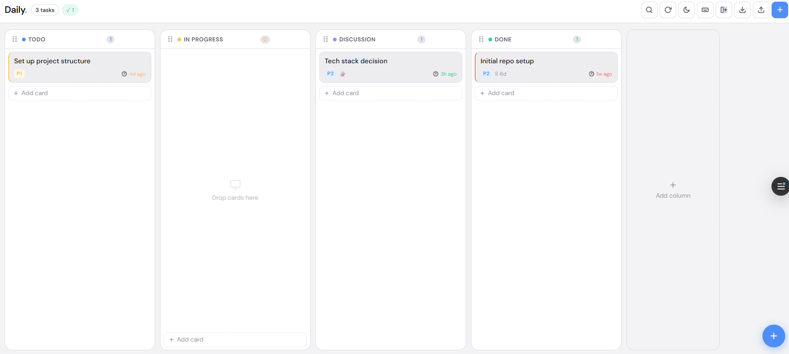

# Daily. 📅

> A clean, minimal, and powerful space for your daily workflow and team collaboration.

Instead of scattering plans, tasks, updates, and notes across multiple platforms — **keep everything in one place**. Daily. is your all-in-one productivity hub, designed for simplicity without sacrificing power.

---

## ✨ What is Daily.?

Daily. is a lightweight yet feature-rich productivity and daily tracking application that adapts to your needs:

- 📝 **Personal Daily Diary** – Capture thoughts, reflections, and daily insights
- ✅ **Task & Work Tracker** – Organize and manage your to-do list with ease
- 📌 **Planning Board** – Visualize your week, sprint, or project in one glance
- 🚧 **Blocker Tracker** – Flag and monitor obstacles that need resolution
- 📊 **Progress Manager** – Track what you've accomplished and stay motivated
- 👥 **Team Collaboration Space** – Work together in real-time with your team

Whether you're a **solo entrepreneur**, **student**, **freelancer**, or **team lead** — Daily. keeps you organized without the clutter.

---

## 🚀 Core Features

### 📋 **Board & Card Management**
- **Intuitive Drag & Drop Workflow** – Move cards between columns effortlessly
- **Custom Status Columns** – Create columns that match your workflow perfectly
- **Rich Card Details** – Add descriptions, attachments, comments, and metadata to cards
- **Priority & Urgency Levels** – Highlight important tasks at a glance
- **Auto Task Aging** – Automatically track how long tasks have been pending

### 📝 **Content & Formatting**
- **Markdown Notes Support** – Write formatted notes with full markdown syntax
- **Image Upload & Text Recognition** – Convert images to text with integrated OCR
- **Base64 Converter** – Encode/decode data directly in the app
- **Diff Checker** – Compare text versions and track changes
- **Drawing Board** – Sketch ideas and visualize concepts
- **JSON Prettifier** – Format and validate JSON with one click

### 🎨 **Design & UX**
- **Minimal & Distraction-Free Design** – Focus on what matters
- **Responsive Board Layout** – Adapts perfectly to desktop, tablet, and mobile
- **Mobile-Friendly Forms & Navigation** – Full functionality on small screens
- **Adaptive Tool Panels** – UI adjusts to your device and preferences
- **Consistent [Lucide Icons](https://lucide.dev/)** – Beautiful, accessible, MIT-licensed icons
- **Dark/Light Theme Toggle** – Easy on the eyes, day or night

### ⌨️ **Productivity Shortcuts**
- **Keyboard Shortcuts & Command Palette** – Navigate and execute actions lightning-fast
- **Interactive Feature Tour** – Guided walkthrough on first use (desktop, tablet, mobile)
- **Replay Tour Anytime** – Learn features at your own pace
- **Tools Menu Launcher** – Access all features from one place
- **Global Search** – Find cards across your entire board instantly

### 🔄 **Sync & Collaboration**
- **Multi-Device Sync** – Your board stays in sync across all devices
- **Automatic Additive Merges** – Changes combine intelligently without data loss
- **Shared Conflict Review** – Resolve conflicts transparently with your team
- **Real-Time Collaborative Editing** – Multiple users editing cards simultaneously
- **Live Presence Indicators** – See who's working on what, right now
- **Follow-Host Card View** – Stay on the same page as your team lead
- **Multi-Person Editing** – Edit the same card together seamlessly
- **Host & Invite System** – Free self-hosted collaborative boards

### 📦 **Data & Reliability**
- **Local Storage Support** – Your data stays on your device when offline
- **JSON Import/Export** – Backup and migrate your boards anytime
- **JSON Syntax Repair** – Automatic recovery of malformed JSON data
- **Partial Recovery** – Unresolved text preserved in recovery reports
- **JSON Diagnostics** – Source locations, fix hints, and detailed warnings
- **Duplicate Key Detection** – Warnings for data integrity issues
- **Integer Precision Loss Detection** – Catch numerical data problems early
- **Intelligent Path Escape Warnings** – Prevent data structure corruption

### 🎯 **Additional Features**
- **Time Machine History** – Review and revert changes from the past
- **Calendar Integration** – Sync events and track deadlines
- **AI Assistants Tool** – Get smart suggestions and assistance
- **Diagram Generator** – Create visual representations of your ideas
- **ZPL Code Generator** – Generate printer labels directly
- **Task Comments** – Collaborate on individual cards with threaded comments
- **Built-in Timers** – Track time spent on tasks
- **Push Notifications** – Never miss important updates
- **Progressive Web App** – Install as an app on your device
- **Accessibility First** – Labeled tools and accessible action names throughout

---

## 💡 Why Choose Daily.?

In a world of bloated productivity tools, Daily. stands out:

✅ **Simple, Not Simple-Minded** – All the power you need, none of the complexity  
✅ **Privacy-First** – Your data stays local by default; sync is optional  
✅ **No Account Required** – Start immediately, no sign-up friction  
✅ **Free & Self-Hosted** – Run it yourself or use our Vercel deployment  
✅ **Collaborative** – Team features without the enterprise bloat  
✅ **Mobile Native** – Full-featured experience on every device  
✅ **Zero Learning Curve** – Intuitive design that feels natural from day one  

---

## 🛠 Tech Stack

Built with modern, lightweight technologies:

| Layer | Technology |
| --- | --- |
| **Frontend** | React + Vanilla CSS |
| **State & Sync** | Custom Sync Engine (Operational Transform Protocol) |
| **Collaboration** | WebSocket (Real-time multiplayer) |
| **Storage** | LocalStorage + Optional Relay Server |
| **Deployment** | Vercel (Frontend) + Render (Relay Server) |
| **Testing** | Node.js Built-in Test Runner |
| **Package Manager** | npm |

### Backend Dependencies
- **ws** (^8.21.0) – WebSocket server for real-time sync
- **diff** (^9.0.0) – Text diffing engine for conflict resolution

---

## 🌐 Live Demo

**Try Daily. right now:**  
👉 [**Open Daily.**](https://daily-one-coral.vercel.app/)

---

## ⌨️ Keyboard Shortcuts & Feature Tour

### Getting Started
New browsers automatically show an **interactive guided tour** of every feature. Navigate with arrow keys or Next/Back buttons. Press **Escape** to skip anytime. Your progress is remembered automatically.

**Replay anytime:** Press **H** or use **Tools → Replay Tour**

### Global Shortcuts

| Key(s) | Action | Description |
| --- | --- | --- |
| **N** | New Card | Create a new task or note |
| **W** | New Column | Add a new status column |
| **/** | Search | Find cards by title or content |
| **E** | Scratch Pad | Quick note-taking space |
| **D** | Drawing Board | Sketch and visualize ideas |
| **A** | AI Assistants | Get intelligent suggestions |
| **O** | Image → Text | Extract text from images (OCR) |
| **F** | Diff Checker | Compare versions and track changes |
| **B** | Base64 Converter | Encode/decode data |
| **G** | Diagrams | Create flowcharts and visual diagrams |
| **J** | JSON Prettifier | Format and validate JSON |
| **Z** | ZPL Generator | Create printer labels |
| **C** | Calendar Events | View and sync calendar |
| **M** | Time Machine | Browse history and revert changes |
| **S** | Collaborate & Sync | Set up multi-device sync |
| **V** | Review Conflicts | Resolve sync conflicts |
| **R** | Refresh Ages | Update task age counters |
| **L** | Toggle Theme | Switch between light/dark mode |
| **P** | Notifications | Enable push notifications |
| **I** | Import Board | Load board JSON backup |
| **X** | Export Board | Save board JSON backup |
| **U** | Install App | Add to home screen (PWA) |
| **K** | Tools Menu | Open all features |
| **H** | Replay Tour | See guided tour again |
| **?** | Shortcuts | View this shortcut guide |
| **Escape** | Close/Clear | Exit dialogs and clear search |

### Card-Specific Controls
Inside an open card, you can:
- Manage **Priority Levels** – Set task importance
- Add **Comments** – Collaborate on card details
- Start **Timers** – Track time spent
- **Move Card** – Drag to another column
- **Delete Card** – Remove from board

💡 **Note:** Destructive operations (delete) are not assigned global shortcuts for safety.

### Advanced Features
- **Markdown Editor:** Use **Ctrl+M** / **Ctrl+Shift+M** for inline/block math
- **Diff Checker:** Use **F7** / **Shift+F7** to navigate between changes
- **Board Import:** Replaces current board — always export a backup first!

---

## 🔄 Multi-Device Sync & Collaboration

### How It Works
Daily.'s sync engine is built on **Operational Transform Protocol** for conflict-free merging:

- **Boards, Cards, Comments & Scratch Pad** – Synced across all devices
- **Local-Only Data** – Calendar events, timers, utility inputs, and panel positions stay on each device
- **Automatic Merging** – Independent changes from different devices combine intelligently
- **Conflict Resolution** – Competing edits are flagged for manual review with full context
- **Real-Time Collaboration** – Multiple users editing the same card simultaneously
- **Presence & Awareness** – See who's online and what they're working on
- **Offline Support** – Changes queue locally and sync when you reconnect

### Sync Behaviors

| Scenario | Behavior |
| --- | --- |
| **New Cards (Both Devices)** | Both cards are kept; neither replaces the other |
| **Text Insertions (Different Places)** | Merged automatically without dropping text |
| **Text Deletions or Replacements** | Flagged for review — you choose which version wins |
| **Simultaneous Field Edits** | Conflict dialog shows alternatives + line/word diff |
| **Same Edit from Different Devices** | Automatically resolved (timestamp-independent) |
| **Offline & Reconnect** | Pending changes re-sent; conflicts re-opened |

### Team Collaboration Setup

1. **Host invites team members** – Share your room ID
2. **Members join the same room** – Live updates start immediately
3. **See who's online** – Presence indicators show active users
4. **Edit together** – Multiple people can work on the same card
5. **Review conflicts** – Use the conflict dialog to merge edits manually

💡 **No sign-up required** — just share your room ID and start collaborating!

---

## 🚀 Getting Started Locally

### Prerequisites
- **Node.js** (v16+)
- **npm** (v8+)

### Installation & Setup

1. **Clone the repository:**
   ```powershell
   git clone https://github.com/ShubhamYadav25/Daily.git
   cd Daily
   ```

2. **Install backend dependencies:**
   ```powershell
   npm ci --prefix Backend
   ```

3. **Run tests (optional):**
   ```powershell
   npm test --prefix Backend
   ```

4. **Start the sync relay:**
   ```powershell
   npm start --prefix Backend
   ```
   The relay server runs on `http://localhost:8080`

5. **Open the app:**
   - **Option A:** Navigate to `http://localhost:8080` (automatic relay connection)
   - **Option B:** Open `index.html` and append `?syncServer=ws%3A%2F%2Flocalhost%3A8080` to use the local relay

6. **Test multi-device sync:**
   - Create a new room in Daily.
   - On another device/browser, join the same room ID
   - Watch changes sync in real-time!

💡 **Local Network Testing:** Use your relay computer's actual IP address, not `localhost`, when testing from other physical devices.

---

## 📦 Deployment

### Hosting & Deployment Options

#### Option 1: Vercel (Recommended for Quick Start)
- Frontend automatically deployed to Vercel
- Zero configuration needed
- Use default relay: `wss://daily-2.onrender.com`

#### Option 2: Self-Hosted (Full Control)
Deploy all components together:

1. **Backend:** Deploy [Backend/server.js](Backend/server.js)
2. **Sync Engine:** Include [sync-engine.js](sync-engine.js)
3. **Frontend:** Deploy the React frontend
4. **Reload Clients:** Update all connected clients after deployment

### Architecture & Limitations

**Relay Behavior:**
- **No Content Authority** – Relay merges records, broadcasts decisions, doesn't control content
- **In-Memory Storage** – Room state is held in memory while clients are connected
- **No Persistent Database** – Recovery depends on at least one client's retained local history
- **Always Export Backups** – Before clearing browser storage, export your board as JSON

**Data Security:**
- **No Account Authentication** – Room IDs are access tokens
- **No End-to-End Encryption** – Use HTTPS/WSS for deployed sync
- **Share Wisely** – Only share room IDs with trusted collaborators
- **Storage Full Alerts** – App notifies you if local storage is exhausted

### Testing

Run frontend shortcut tests from the repository root:

```powershell
node --test frontend.test.js
```

---

## 👥 Live Collaborative Boards (Teams & Groups)

### Getting Started with Collaboration

1. **Open Daily.** and select **Collaborate** (desktop or mobile)
2. **Enter your name** and sync server URL (optional)
3. **Host a shared board** or **join an existing room**
4. **Share the invite link** with teammates

### How Live Collaboration Works

**What's Shared:**
- ✅ Columns and cards
- ✅ Card content (title, notes, priority, color)
- ✅ Comments and metadata
- ✅ Scratch Pad

**What Stays Local:**
- 🔒 Calendar events
- 🔒 Timers
- 🔒 Utility inputs
- 🔒 Panel positions

### Live Features

| Feature | Description |
| --- | --- |
| **Live Cursors** | See everyone's mouse pointer with their name labeled |
| **Real-Time Editing** | Changes appear instantly while collaborators type |
| **Presence Indicators** | Shows who's online and viewing which cards |
| **Follow Host** | Automatically view the card the host is working on |
| **Instant Sync** | 80ms batching + network latency; truly competitive edits get conflict review |
| **No Subscriptions** | Completely free on self-hosted servers |
| **Conflict Resolution** | Shared conflict dialog for competing edits |

### Completely Free Local/LAN Setup

**Single Network:**
```powershell
npm start --prefix Backend
# On other devices: http://YOUR-LAN-IP:8080
```

**Remote Internet Collaboration:**
- Deploy relay on a reachable machine
- Enter `wss://your-domain.com` as sync server
- HTTPS pages require WSS connections

💡 **Room Persistence:** Rooms stay in relay memory until backend restart. Export important boards regularly.

---

## 🔐 Data Privacy & Security

✅ **Privacy by Default**  
- No account required
- No signup or login
- Data stays on your device (LocalStorage)
- Optional sync only when you enable it

✅ **Export & Backup**  
- Export your entire board as JSON anytime
- Backup before clearing browser storage
- Restore from JSON backup anytime

⚠️ **Security Notes**  
- Use HTTPS/WSS for sync over the internet
- Room IDs grant full access — share only with trusted people
- No end-to-end encryption — suitable for internal teams, not high-security use cases
- Always keep local backups of important boards

---

## 📸 Screenshots



---

## 🤝 Contributing

Have ideas for improvements? Found a bug? We'd love your feedback!

- **Report Issues** – Open an issue on GitHub
- **Suggest Features** – Share your ideas in discussions
- **Fork & Contribute** – Submit pull requests for bug fixes and features

---

## 📄 License

[View License](LICENSE)

---

## ❤️ Support

If Daily. helps you stay organized, consider:

- **⭐ Star this repository** – Spread the word!
- **📣 Share with friends** – Help others discover Daily.
- **💬 Give feedback** – Your ideas make Daily. better
- **🐛 Report bugs** – Help us improve reliability

---

## 🚀 What's Next?

**Planned Features & Improvements:**
- 📱 Native mobile apps (iOS, Android)
- 🔗 Integrations (Slack, Teams, Zapier)
- 📊 Advanced analytics & insights
- 🎨 Custom themes & branding
- 📲 Offline-first enhancements
- 🤖 AI-powered features

**Have a feature request?** Let us know! Your feedback shapes Daily.'s future.

---

**Built with ❤️ for makers, students, teams, and everyone in between.**

Start using Daily. today and reclaim your productivity. 🚀